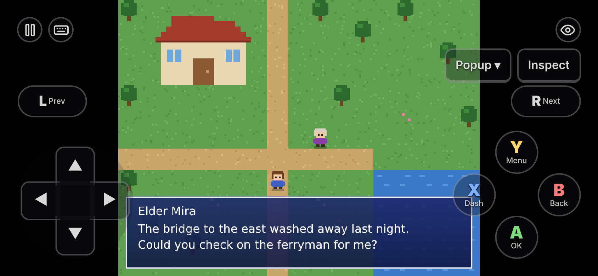
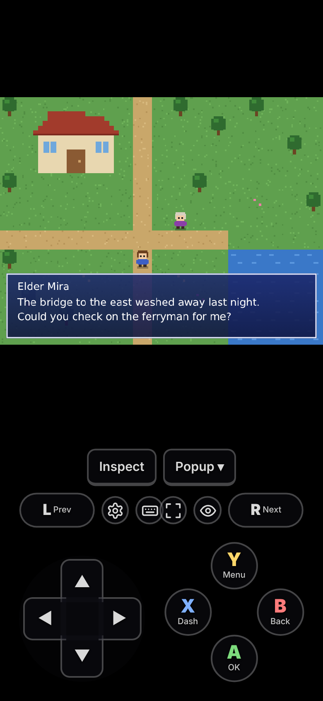
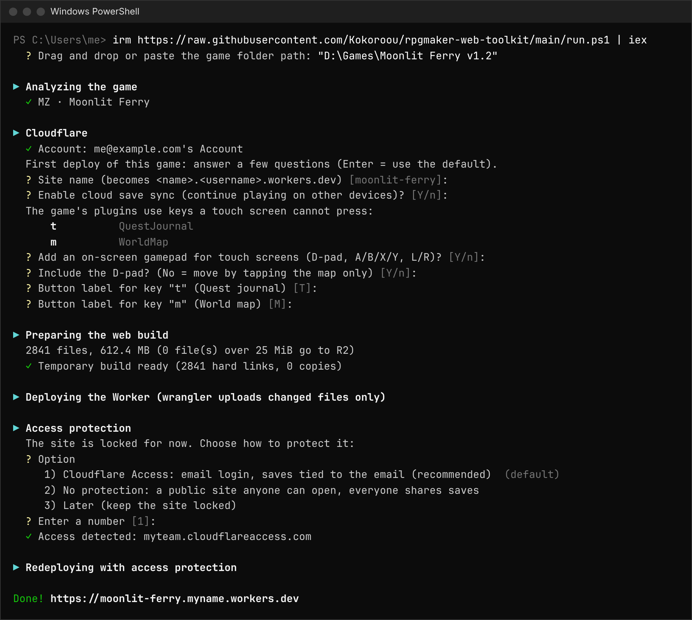
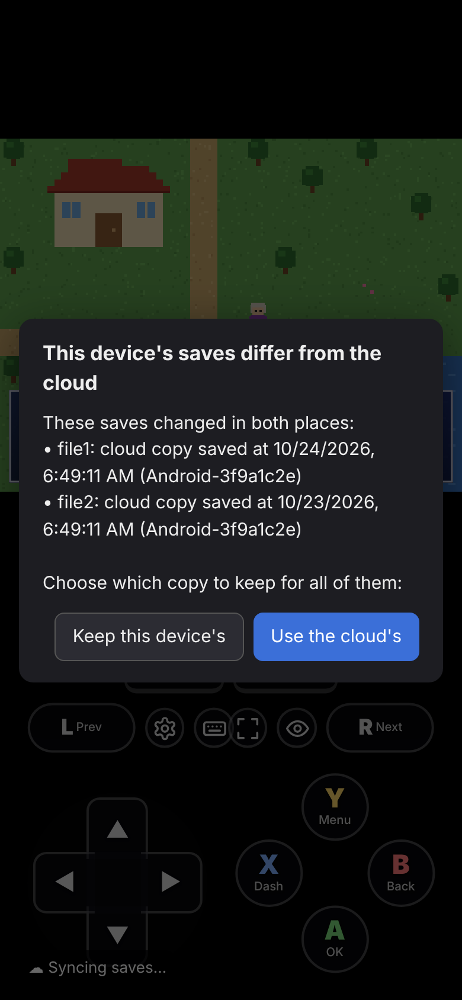
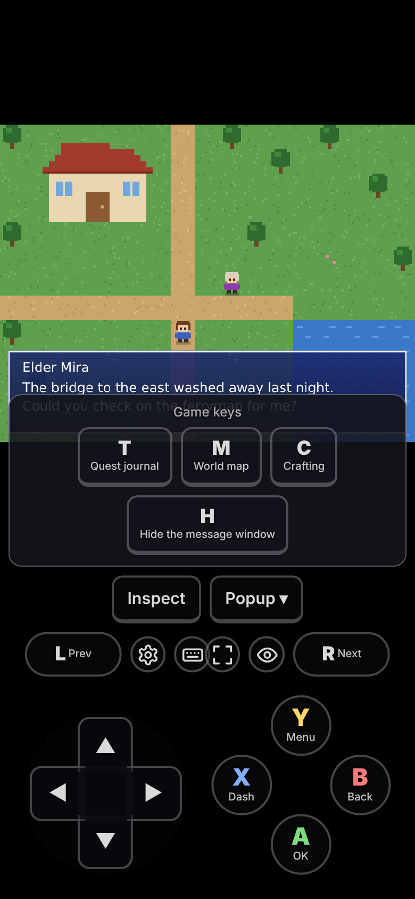
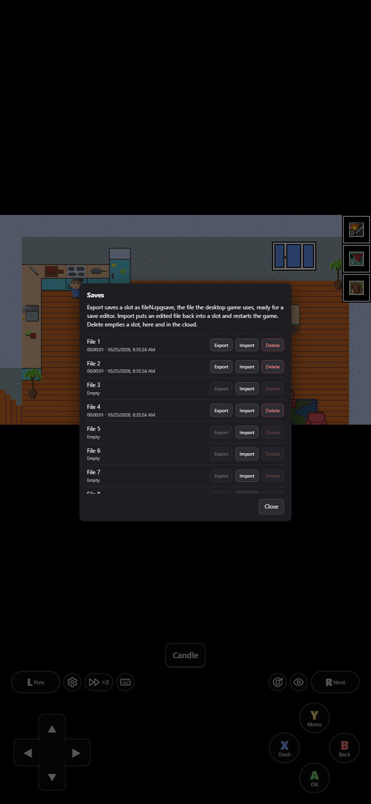
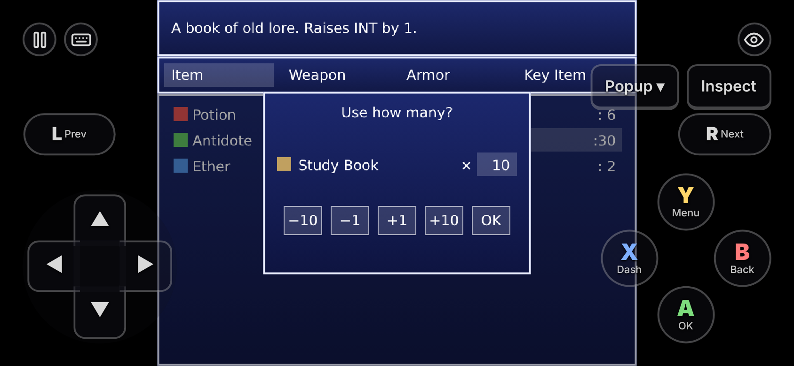
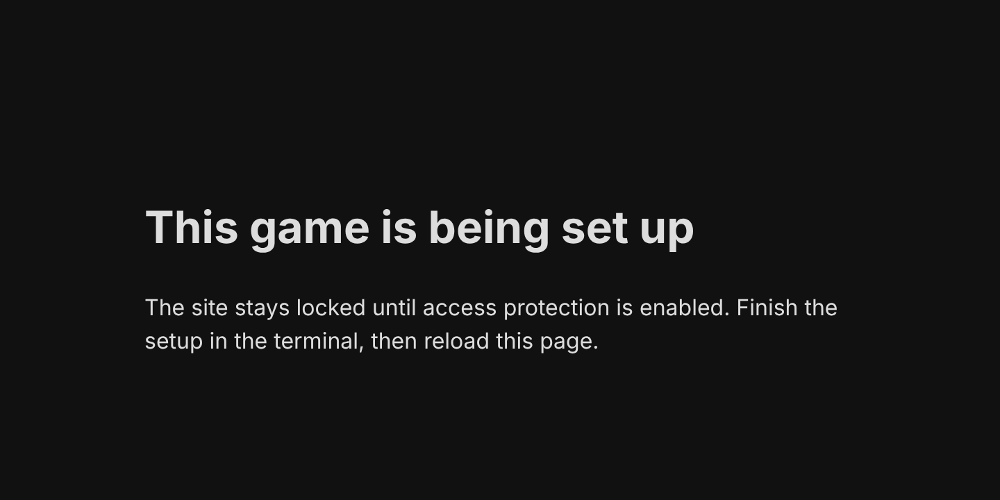

# rpgmaker-web-toolkit

Put an **RPG Maker MZ or MV** game online with one command, on **Cloudflare Workers' free plan**. Play it in any browser, with cloud saves and an on-screen gamepad on phones.

<p align="center">
  
  
</p>

<p align="center"><sub>Screenshots: <a href="https://yancharkin.itch.io/gamedev-the-beginning">GameDev: The Beginning</a> by yancharkin, <a href="https://creativecommons.org/licenses/by-sa/4.0/">CC BY-SA 4.0</a></sub></p>

**📖 User guide: https://kokoroou.github.io/rpgmaker-web-toolkit/**

## Quick start

Windows with [Node.js](https://nodejs.org) 24+, and a free [Cloudflare account][cloudflare] (it asks for a payment method to turn on R2 and Access, even for free use). In PowerShell:

```powershell
irm https://raw.githubusercontent.com/Kokoroou/rpgmaker-web-toolkit/main/run.ps1 | iex
```

Drop the game folder in, answer a few questions, and get a link:



Step by step: [Before you start][requirements] → [Set up Cloudflare][cloudflare] → [First deploy][first-deploy] → [Protect the site][access].

## Features

| | |
|---|---|
|  | **Cloud saves.** Same email, any device. Offline saves upload later, and two devices never silently overwrite each other. [More][saves] |
|  | **Touch controls.** D-pad, A/B/X/Y and L/R like JoiPlay, plus buttons for the keys the game's plugins use. Players can move or hide any button. [More][controls] |
|  | **Save files.** Export a slot as a desktop save, edit it, import it back, or delete it. [More][save-files] |
|  | **Several items at once.** Use 10 potions in one go. [More][items] |
|  | **Private by default.** Locked until Cloudflare Access (email login) is on. [More][access] |

Updates upload only the files that changed. A new toolkit version also reaches a game whose folder you deleted, from its link alone ([updating][updating]). The game folder is never modified ([how it works][how]).

## Responsible use

For playing a game **you own**, on your own devices. A public or widely shared site is redistribution, which only the game's creators can allow. Creators can say what they allow with a [hosting policy][policy], and may use the toolkit for anything with their own games: see [For game creators][creators].

## More

- [Commands][commands] · [Config keys][config] · [Free plan limits][limits] · [Troubleshooting][troubleshooting] · [Credits and licenses][credits]
- Working on the toolkit: [CONTRIBUTING.md](CONTRIBUTING.md) · [Roadmap](docs/ROADMAP.md) · [Impact (Vietnamese)](docs/IMPACT.md)

## License

[PolyForm Noncommercial 1.0.0](LICENSE), plus a **Game Creators** permission: use it freely for noncommercial purposes. For a game you own or publish with its owner's permission, any use is allowed, commercial included, and so is shipping the `runtime/` plugins inside it. Hosting other people's games for money, offering it as a hosting service, or selling the toolkit is not.

The game screenshots (`site/public/img/`) show *GameDev: The Beginning* by yancharkin and are licensed [CC BY-SA 4.0](https://creativecommons.org/licenses/by-sa/4.0/), not under the toolkit's license: see [Credits and licenses][credits]. Cloudflare and RPG Maker are trademarks of their owners; this project is not affiliated with them.

<!-- Each link goes to the published page of a file in site/ -->
[requirements]: https://kokoroou.github.io/rpgmaker-web-toolkit/setup/requirements
[cloudflare]: https://kokoroou.github.io/rpgmaker-web-toolkit/setup/cloudflare
[first-deploy]: https://kokoroou.github.io/rpgmaker-web-toolkit/setup/first-deploy
[access]: https://kokoroou.github.io/rpgmaker-web-toolkit/setup/access
[updating]: https://kokoroou.github.io/rpgmaker-web-toolkit/setup/updating
[troubleshooting]: https://kokoroou.github.io/rpgmaker-web-toolkit/setup/troubleshooting
[saves]: https://kokoroou.github.io/rpgmaker-web-toolkit/play/saves
[controls]: https://kokoroou.github.io/rpgmaker-web-toolkit/play/controls
[save-files]: https://kokoroou.github.io/rpgmaker-web-toolkit/play/save-files
[items]: https://kokoroou.github.io/rpgmaker-web-toolkit/play/items
[commands]: https://kokoroou.github.io/rpgmaker-web-toolkit/reference/commands
[config]: https://kokoroou.github.io/rpgmaker-web-toolkit/reference/config
[limits]: https://kokoroou.github.io/rpgmaker-web-toolkit/reference/limits
[credits]: https://kokoroou.github.io/rpgmaker-web-toolkit/reference/credits
[how]: https://kokoroou.github.io/rpgmaker-web-toolkit/reference/how-it-works
[creators]: https://kokoroou.github.io/rpgmaker-web-toolkit/creators/
[policy]: https://kokoroou.github.io/rpgmaker-web-toolkit/creators/policy
